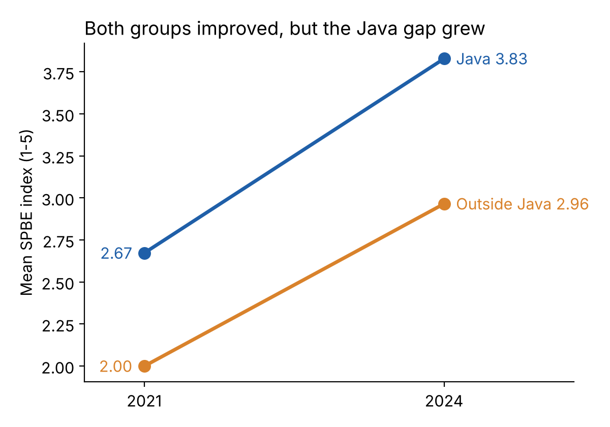
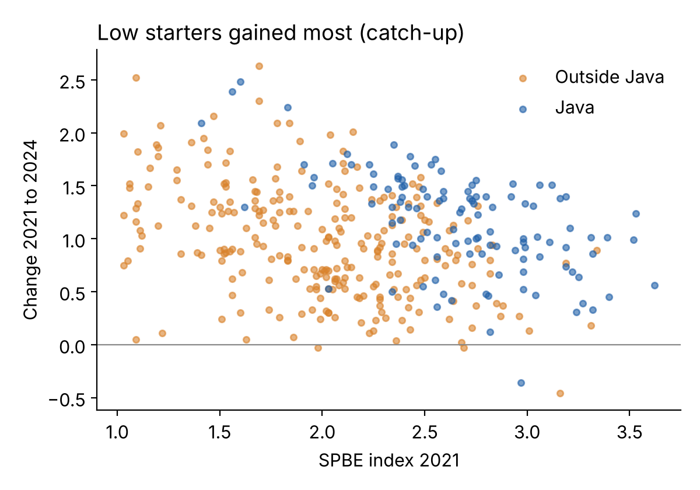

# Is Indonesia's Digital Government Gap Closing? SPBE Scores of Regencies and Cities, 2021–2024

A personal research project. I built a dataset of the official digital government (SPBE) scores of Indonesian regencies and cities for 2021 and 2024, matched it with public socio-economic data, and asked: **did the regions that started behind catch up?**



## Key findings

1. **Almost everyone improved.** Among 373 regencies and cities scored in both years, 99% improved. The mean score rose from 2.20 to 3.23 (scale 1–5).
2. **Scores became more equal overall.** Regions that started low gained the most, and the coefficient of variation fell from 0.26 to 0.20.
3. **But the Java gap grew.** The raw difference between Java and the rest of Indonesia rose from **0.67 to 0.86 points**. Comparing regions with the same 2021 score, HDI, poverty rate, population, city/regency status and internet use, regions in Java still improved **0.42 points more** (t = 4.0, standard errors clustered by province).
4. **Human development matters.** Higher HDI, larger population and higher internet use are linked with faster improvement.



**Why it matters:** if support for digital government is spread evenly, the gap between Java and other regions may keep growing. Regions outside Java may need more targeted help.

## Data

`data/spbe_regions_2021_2024.csv`: 523 regional governments (provinces, regencies, cities), one row each. All sources are public.

| Column | Meaning | Source |
|---|---|---|
| `spbe_2021`, `predikat_2021` | SPBE index and rating, 2021 evaluation | Keputusan Menteri PANRB No. 1503 Tahun 2021 |
| `spbe_2024`, `predikat_2024` | SPBE index and rating, 2024 evaluation | Keputusan Menteri PANRB No. 663 Tahun 2024 |
| `change_2021_2024` | `spbe_2024 - spbe_2021` | computed |
| `hdi_2021`, `hdi_2024` | Human Development Index (IPM) | BPS |
| `poverty_2021`, `poverty_2024` | Poverty rate (P0, %) | BPS |
| `poor_2021`, `pop_2021_thousand` | Number of poor people; population (thousands) | BPS |
| `internet_2021`, `internet_2024` | Share of population using the internet, **province level** | BPS |
| `innovation_2024` | Regional Innovation Index 2024 | Keputusan Mendagri No. 400.10.11-4898 Tahun 2024 |

Scores were extracted from the decree PDFs and spot-checked against the originals.

## How to reproduce

```
pip install -r requirements.txt
python analysis.py
```

This prints and saves `results.txt` and redraws the two figures.

## Method

- Sample: regencies and cities scored in both years. 2021 scores of exactly 1.00 are dropped because they look like a floor or "not assessed".
- Regression of the 2021–2024 change on the 2021 score, HDI, poverty, log population, city dummy, Java dummy and internet use, with standard errors clustered by province (35 clusters).

## Limitations

- **The scoring guide changed** in 2023 and 2024 (stricter in some indicators, easier in others). Part of the national rise may come from the new rules rather than real progress. Relative comparisons (Java vs outside Java) are less affected than levels.
- **102 regencies and cities have no 2021 score**, none of them in Java. They are poorer and smaller on average, so the sample leans towards stronger regions.
- Internet use is only available at province level.
- These are associations, not causes.

## Author

Wira Fattah Pasha, October 2026. Views are my own. Feedback welcome via GitHub issues.
